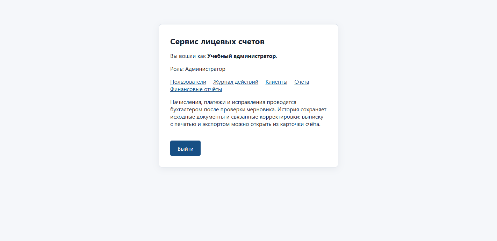
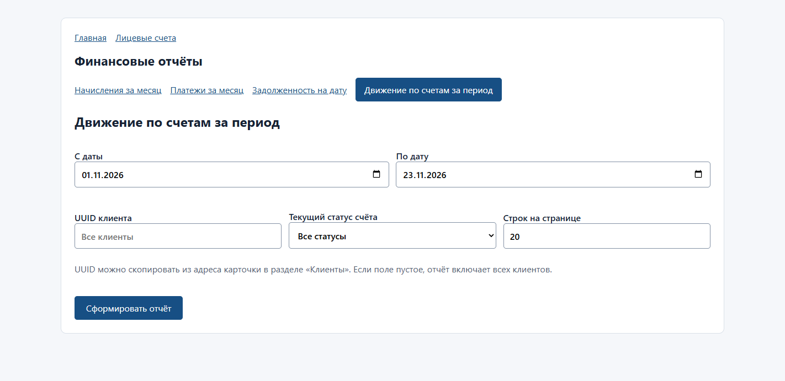
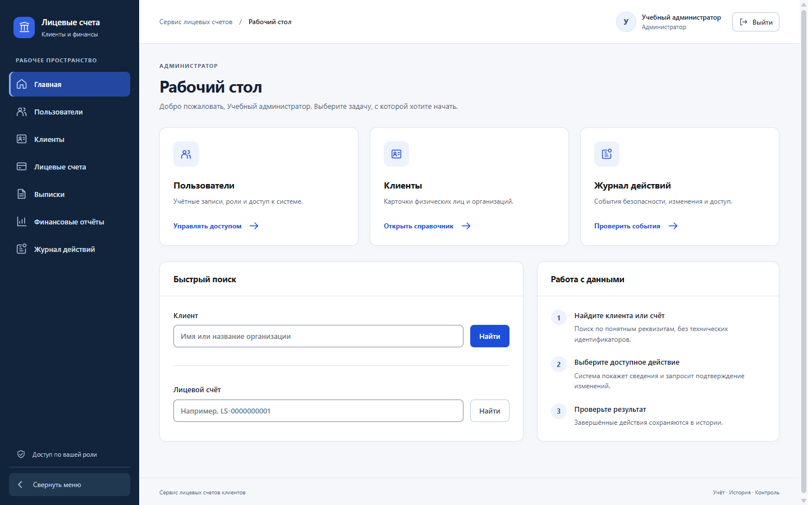
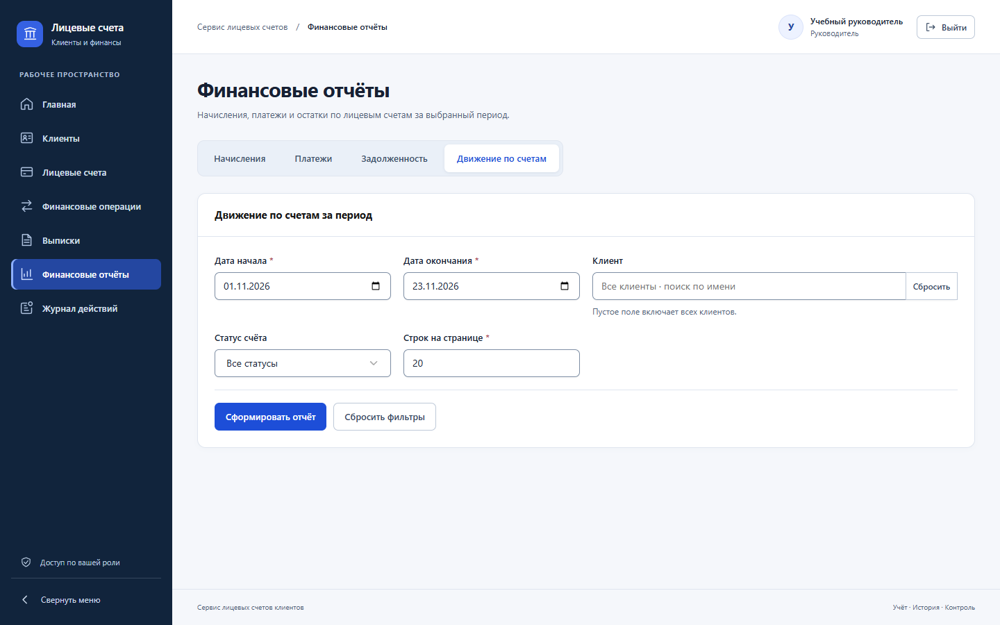
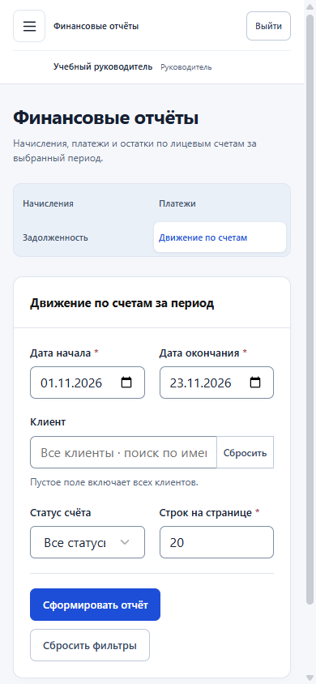
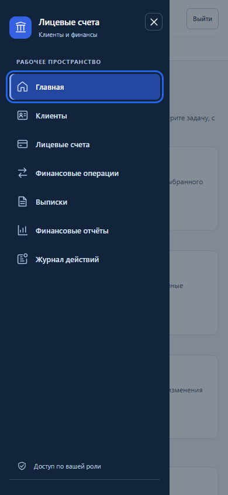
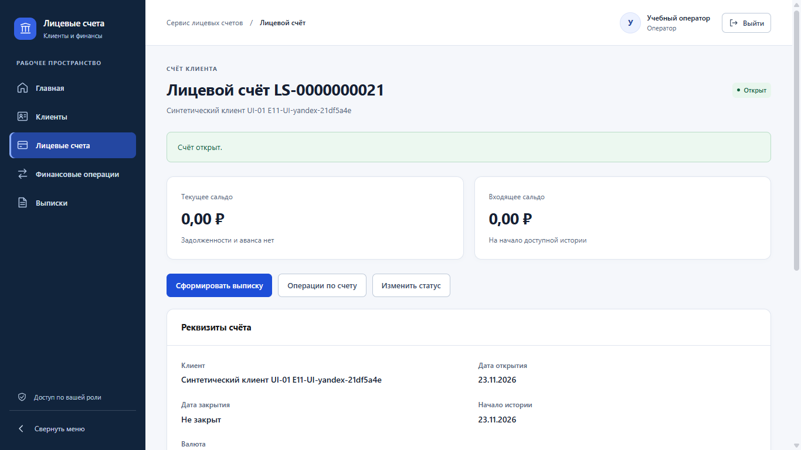
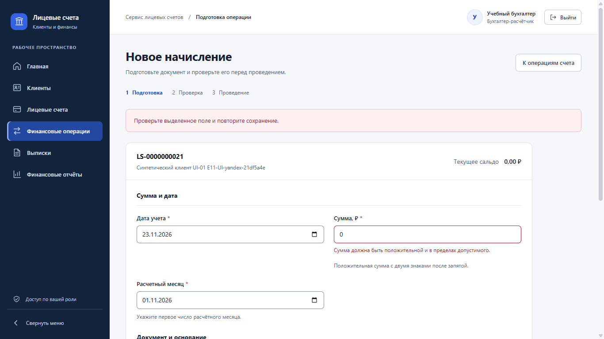
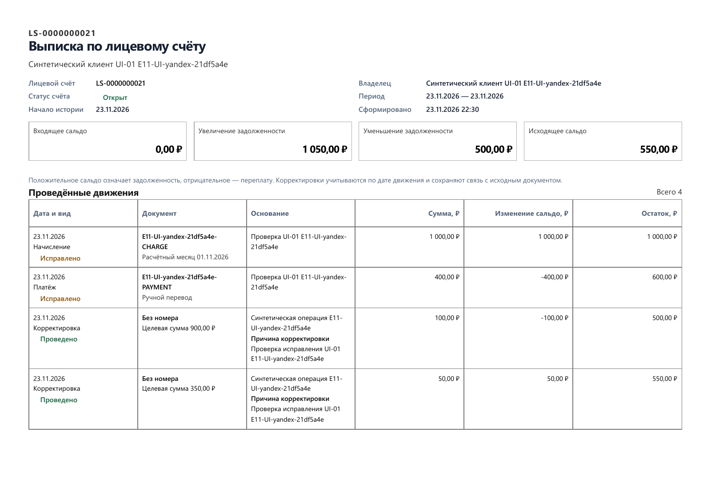

# Интерфейс до и после

23.11.2026. Итоговая браузерная приёмка — Яндекс Браузер 26.10.3.771. Снимки до изменения и общий обход после изменения сохранены отдельно; их размеры и маршруты записаны в manifest.json.

## До

## После

### Главная администратора

### Фильтры отчёта

### Отчёт на телефоне

### Мобильная навигация

### Карточка счёта

### Ошибка финансового поля

### Выписка A4

[Протокол окончательных 20 сценариев](evidence/ui-redesign-2026-11-23/yandex/result.json). Остальные страницы и размеры доступны в соседнем каталоге yandex.
